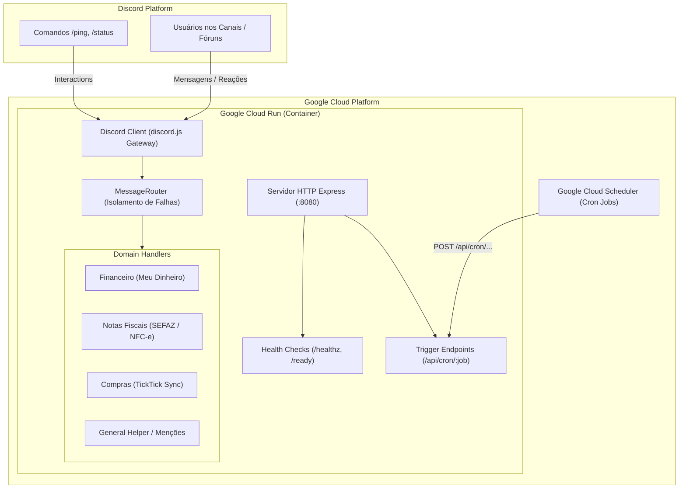

# 🤖 Discord Family Bot (`discord-family-bot-br`)

Bot modular para Discord voltado para automação, organização e gestão de rotinas familiares (finanças, compras de supermercado, conciliação de notas fiscais/NFC-e, agenda compartilhada e manutenções).

Projetado especificamente para execução escalável e segura em contêiner no **Google Cloud Run**.

---

## 📐 Arquitetura

O bot opera com uma arquitetura híbrida de **Discord Gateway (WebSocket)** e **Servidor HTTP (Express)** para atender aos requisitos de contêineres gerenciados pelo Google Cloud Run e permitir gatilhos via Cloud Scheduler:



---

## ✨ Principais Funcionalidades desta Arquitetura Base

- **Pronto para o Google Cloud Run**: Servidor HTTP embutido respondendo na porta `$PORT` (8080) com probes de `/healthz` (liveness) e `/ready` (readiness verificando a conexão do bot).
- **Roteador Modular de Mensagens (`MessageRouter`)**: Desacopla regras de negócio em handlers isolados (`ChannelHandler`), facilitando a adição de novas integrações sem poluir os eventos centrais.
- **Suporte a Tópicos de Fóruns e Threads**: O roteador extrai metadados de tópicos (`isThread`, `parentId`), permitindo fluxos em fóruns como organização de viagens e orçamentos.
- **Gatilhos Agendados (Cron Jobs)**: Endpoint protegido por `CRON_SECRET` pronto para receber chamadas agendadas do Google Cloud Scheduler (ex: alertas de vencimento às 8h, resumo semanal aos domingos).
- **Slash Commands**: Registro automático de comandos de barra (`/ping`, `/status`) no servidor de desenvolvimento (Guild) ou globalmente.
- **Validação com Zod**: Variáveis de ambiente fortemente tipadas e validadas no boot da aplicação com mensagens de erro claras.
- **Suíte de Testes com Vitest & Supertest**: Testes unitários e de integração com execução rápida, mocks limpos e cobertura de código.
- **Multi-Stage Dockerfile**: Imagem enxuta baseada em Alpine Linux, rodando com usuário sem privilégios (`appuser`) para máxima segurança em produção.

---

## 📁 Estrutura do Projeto

```text
.
├── Dockerfile                  # Multi-stage build otimizado para Cloud Run
├── .dockerignore               # Otimização de contexto de build
├── .env.example                # Template de variáveis de ambiente
├── package.json                # Dependências e scripts
├── tsconfig.json               # Configurações TypeScript
├── vitest.config.ts            # Configurações de teste Vitest
├── AGENTS.md                   # Diretrizes para agentes de IA
├── README.md                   # Esta documentação
└── src/
    ├── index.ts                # Ponto de entrada e Graceful Shutdown
    ├── config/                 # Validação de variáveis de ambiente com Zod
    ├── server/                 # Servidor HTTP para Probes do Cloud Run e Cron
    ├── bot/                    # Setup do cliente Discord e handlers de eventos
    ├── commands/               # Slash Commands (/ping, /status)
    ├── routing/                # Roteamento de mensagens por canal/fórum
    └── handlers/               # Handlers de domínio específicos (financeiro, notas, etc.)
```

---

## 🚀 Como Executar Localmente

### Pré-requisitos
- **Node.js**: Versão `>= 20.0.0` (recomendado v22 ou v24)
- **npm**: Versão `>= 10.0.0`
- **Conta de Desenvolvedor no Discord**: Crie um Bot no [Discord Developer Portal](https://discord.com/developers/applications) e ative os **Privileged Gateway Intents** (`Message Content Intent`).

### 1. Clonar e Instalar Dependências
```bash
git clone https://github.com/seu-usuario/discord-family-bot-br.git
cd discord-family-bot-br
npm install
```

### 2. Configurar Variáveis de Ambiente
Copie o template e preencha com suas credenciais:
```bash
cp .env.example .env
```
Campos mínimos obrigatórios no `.env`:
```ini
NODE_ENV=development
PORT=8080
DISCORD_TOKEN=seu_bot_token_do_discord_aqui
DISCORD_CLIENT_ID=seu_client_id_aqui
DISCORD_GUILD_ID=seu_servidor_de_testes_aqui
```

### 3. Executar em Modo de Desenvolvimento
```bash
npm run dev
```

### 4. Atualizar os Slash Commands no Discord
Para registrar ou atualizar os comandos de barra (`/ping`, `/status`, etc.) na API do Discord:
```bash
# Registra na guilda do DISCORD_GUILD_ID (atualização instantânea para desenvolvimento)
npm run deploy:commands

# Ou força registro global (visível em todos os servidores do bot)
npm run deploy:commands -- --global

# Ou registra em uma guilda específica
npm run deploy:commands -- --guild SEU_GUILD_ID

# Ou limpa comandos registrados
npm run deploy:commands -- --clear
```

### 5. Como Testar Comandos e Canais via HTTP (Zero Socket)

A aplicação opera em modo **100% HTTP** (sem abrir conexões WebSocket). Você pode disparar comandos e simular mensagens de canais diretamente por chamadas HTTP:

```bash
# Testar comando /ping
curl -X POST http://localhost:8080/api/commands/ping

# Testar comando /status
curl -X POST http://localhost:8080/api/commands/status

# Enviar comando/mensagem simulando o canal de notas fiscais
curl -X POST http://localhost:8080/api/channels/messages \
  -H "Content-Type: application/json" \
  -d '{
    "channel": "notas-fiscais",
    "content": "https://nfe.sefaz.ba.gov.br/portal/nfce/qrcode.aspx?p=...",
    "author": "Albertto"
  }'

# Enviar mensagem simulando o canal financeiro
curl -X POST http://localhost:8080/api/channels/financeiro/messages \
  -H "Content-Type: application/json" \
  -d '{
    "content": "Combustível R$ 150",
    "author": "Albertto"
  }'
```

### 6. Executar os Testes Automatizados
```bash
# Executa a suíte de testes unitários e de integração
npm test

# Executa testes com relatório de cobertura
npm run test:coverage

# Checagem estática de tipos
npm run typecheck
```

---

## ☁️ Deploy no Google Cloud Run

Como o bot do Discord mantém conexão contínua via WebSocket com o Gateway, o serviço no Cloud Run deve ser configurado com **CPU sempre alocada** (`--no-cpu-throttling`) e pelo menos **1 instância ativa** (`--min-instances 1`).

### 1. Build e Deploy via Google Cloud CLI (`gcloud`)

```bash
# Definir projeto no GCP
gcloud config set project SEU_PROJETO_GCP

# Realizar o deploy direto a partir do código-fonte (Cloud Build constrói o Dockerfile)
gcloud run deploy discord-family-bot \
  --source . \
  --region southamerica-east1 \
  --platform managed \
  --allow-unauthenticated \
  --min-instances 1 \
  --max-instances 1 \
  --no-cpu-throttling \
  --port 8080 \
  --set-env-vars NODE_ENV=production \
  --set-secrets DISCORD_TOKEN=discord-bot-token:latest,CRON_SECRET=cron-secret:latest
```

> **Dica de Segurança**: Armazene o `DISCORD_TOKEN` e `CRON_SECRET` no **Google Secret Manager** e referencie com `--set-secrets`.

### 2. Configurar Agendamentos com o Google Cloud Scheduler

Para disparar rotinas periódicas (como avisos de contas ou resumos):
```bash
# Exemplo: Disparo diário às 08:00 (Fuso de Brasília)
gcloud scheduler jobs create http alerta-boletos-diario \
  --location=southamerica-east1 \
  --schedule="0 8 * * *" \
  --time-zone="America/Bahia" \
  --uri="https://SEU-SERVICO-CLOUD-RUN.a.run.app/api/cron/alerta-boletos" \
  --http-method=POST \
  --headers="Authorization=Bearer SEU_CRON_SECRET"
```

---

## 🧩 Como Adicionar Novos Handlers de Canal

Basta criar uma classe que implemente a interface `ChannelHandler`:

```typescript
import { ChannelHandler, MessageContext } from "./routing/types.js";

export class ExemploHandler implements ChannelHandler {
  public readonly name = "ExemploHandler";
  public readonly description = "Descrição do propósito deste canal";

  public canHandle(context: MessageContext): boolean {
    // Retorne true se a mensagem deve ser processada por este handler
    return context.channelName === "meu-canal";
  }

  public async handle(context: MessageContext): Promise<void> {
    await context.message.reply("Processado com sucesso!");
  }
}
```

E registrá-la no `MessageRouter` dentro de `src/index.ts`:
```typescript
router.register(new ExemploHandler());
```

---

## 🗺 Roadmap de Implementações (Integrado ao TickTick)

- [x] **Setup da arquitetura base do Bot do Discord** (Node.js/TypeScript, Cloud Run, router e testes).
- [x] **Parser de Nota Fiscal e armazenamento no Google Drive**: Scraping de links SEFAZ / NFC-e e persistência organizada em Google Sheets e Google Drive.
- [ ] **Integração Meu Dinheiro**: Lançamento de despesas e extrato no sistema Meu Dinheiro via chat.
- [ ] **Chat de Compromissos**: Criação automática de eventos no Google Calendar a partir de mensagens.
- [ ] **Lista de Compras Inteligente**: Sincronização com o TickTick e baixa por reações (✅).
- [ ] **Alertas de Boletos e Faturas**: Rotina matinal diária via Cloud Scheduler.
- [ ] **Resumo Semanal Consolidado**: Relatório financeiro aos domingos no canal `#financeiro`.
- [ ] **Registro de Abastecimento e Manutenção do Carro**: Cálculo de km/L e alertas preventivos.
- [ ] **Fórum de Viagens e Férias**: Roteamento por tópicos de destino e divisão de despesas.

---

## 📄 Licença

Distribuído sob a licença [MIT](LICENSE).
