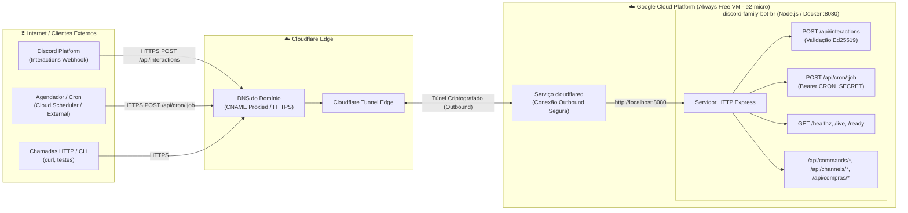

# 🏗️ Documentação de Infraestrutura

Este documento descreve a infraestrutura de hospedagem, rede e exposição pública do **discord-family-bot-br**, utilizando uma instância **Always Free do Google Cloud Platform (GCP)** conectada à internet de forma segura através de um **Cloudflare Tunnel** e **domínio próprio**.

---

## 📌 Visão Geral

A aplicação opera em arquitetura **100% HTTP / Zero Socket** (sem conexão persistente com o Discord Gateway via WebSocket), escutando localmente na porta `8080`.

Em vez de expor o IP público da VM ou abrir portas de entrada (`80`/`443`) no firewall do GCP, todo o tráfego externo entra pelo seu **domínio próprio na Cloudflare**, atravessa um **Cloudflare Tunnel (`cloudflared`)** e chega diretamente ao servidor HTTP local da aplicação.

### Benefícios desta Arquitetura
- **Custo Zero de Infraestrutura**: Utiliza a camada *Always Free* do GCP (Compute Engine `e2-micro`) + plano gratuito do Cloudflare Tunnel.
- **Zero Portas de Entrada Abertas**: O firewall da VPC do GCP não precisa liberar HTTP/HTTPS público; o `cloudflared` estabelece conexões apenas de saída (*outbound-only*) para a borda da Cloudflare.
- **HTTPS / TLS Automático**: A Cloudflare gerencia o certificado SSL/TLS na borda para o seu domínio.
- **Proteção contra DDoS e Ocultação de IP**: O IP real da instância no GCP não fica exposto no DNS público.

---

## 📐 Diagrama de Arquitetura e Fluxo de Rede



---

## 🧩 Componentes da Infraestrutura

### 1. Domínio Próprio & DNS (Cloudflare)
- O domínio é gerenciado pelo DNS da Cloudflare com proxy ativado (**nuvem laranja / Proxied**).
- Um registro `CNAME` aponta o domínio ou subdomínio (ex.: `bot.seudominio.com.br`) para o endereço do túnel (`<TUNNEL_ID>.cfargotunnel.com`).
- A terminação TLS/HTTPS ocorre na borda da Cloudflare, garantindo que o Discord e outros clientes se comuniquem via `https://`.

### 2. Cloudflare Tunnel (`cloudflared`)
- Executado como daemon (`systemd` ou contêiner Docker) dentro da VM do GCP.
- Inicia conexões de saída criptografadas até os data centers da Cloudflare e encaminha as requisições recebidas para a porta local `8080` da aplicação.
- Exemplo de regra de roteamento (*ingress*) no `cloudflared`:

```yaml
tunnel: <TUNNEL_ID>
credentials-file: /etc/cloudflared/<TUNNEL_ID>.json

ingress:
  - hostname: bot.seudominio.com.br
    service: http://localhost:8080
  - service: http_status:404
```

### 3. Servidor Always Free do GCP (Compute Engine `e2-micro`)
- Máquina virtual Linux na camada gratuita do Google Cloud Platform.
- Executa a aplicação `discord-family-bot-br` via **PM2** (gerenciador de processos Node.js configurado nos scripts do `package.json`), diretamente via **Node.js** (`npm start`) ou em contêiner **Docker** (`Dockerfile`), sempre na porta definida por `PORT` (padrão `8080`).
- **Firewall de Entrada (VPC)**: Pode permanecer fechado para tráfego HTTP/HTTPS (`80`/`443`), mantendo apenas acesso administrativo (como SSH via IAP ou IP restrito, se necessário).
- **Tráfego de Saída (Egress)**: A VM precisa de acesso de saída à internet para manter o túnel `cloudflared` ativo e consumir APIs externas (Discord REST API, Google Drive/Sheets, SEFAZ, etc.).

### 4. Aplicação (`discord-family-bot-br`)
Configurada em `src/server/index.ts` e iniciada por `src/index.ts`, expondo os seguintes endpoints via HTTP:

| Rota | Método | Finalidade | Segurança / Validação |
| :--- | :--- | :--- | :--- |
| `/api/interactions` | `POST` | Webhook oficial do Discord para Slash Commands e interações | Assinatura Ed25519 (`x-signature-ed25519` + `DISCORD_PUBLIC_KEY`) |
| `/api/cron/:job` | `POST` | Disparo de rotinas agendadas | Cabeçalho `Authorization: Bearer <CRON_SECRET>` |
| `/healthz`, `/live` | `GET` | Verificação de saúde (*liveness*) | Pública (retorna `uptime` e status `alive`) |
| `/ready` | `GET` | Verificação de prontidão (*readiness*) | Pública (status `ready` em modo `http-serverless`) |
| `/api/commands/:name` | `POST` | Execução direta de comandos via HTTP | Uso administrativo / testes |
| `/api/channels/messages` | `POST` | Simulação/envio de mensagens para roteamento de canais | Uso administrativo / testes |
| `/api/compras/*` | `GET`/`POST`/`DELETE` | APIs REST da Lista de Compras | Uso interno / integrações |

---

## ⚙️ Execução do Servidor na Aplicação (`package.json` & Runtime)

De acordo com o `package.json`, a aplicação é um projeto **Node.js (`>=20.0.0`)** em formato **ESM nativo** (`"type": "module"`), compilado para um bundle único de entrada em `dist/index.js`.

### Fluxo Interno de Inicialização (`src/index.ts`)
1. **Validação de Ambiente**: Carrega e valida as variáveis de ambiente via `dotenv` + `zod` (`src/config/index.ts`), definindo `PORT` (padrão `8080`) e `NODE_ENV`.
2. **Serviços e Roteador**: Instancia `ComprasService` e o `MessageRouter`, registrando os handlers de domínio (`GeneralHelperHandler`, `FinanceiroHandler`, `NotasFiscaisHandler` e `ComprasHandler`).
3. **Servidor HTTP Express (`src/server/index.ts`)**: Inicializa o Express (`^4.21.2`) com middlewares `helmet`, `cors` e `express.json` (preservando `rawBody` para verificação de assinatura Ed25519), passando a escutar em `app.listen(config.PORT)`.
4. **Encerramento Gracioso (*Graceful Shutdown*)**: Escuta os sinais `SIGTERM` e `SIGINT`, fechando o servidor HTTP (`server.close`) antes de encerrar o processo.

### Build e Modos de Execução (`scripts` do `package.json`)

| Comando | Script Executado | Uso Recomendado |
| :--- | :--- | :--- |
| `npm run build` | `esbuild src/index.ts --bundle --platform=node --format=esm --packages=external --outfile=dist/index.js` | Gera o bundle ESM de produção em `dist/index.js` mantendo dependências de `node_modules` externas. |
| `npm run deploy:prod` | `npm run build && (pm2 reload discord-bot \|\| pm2 start dist/index.js --name discord-bot)` | **Deploy em produção na VM GCP**: compila e recarrega (ou inicia) o processo `discord-bot` no **PM2** sem downtime. |
| `npm run pm2:start` | `pm2 start dist/index.js --name discord-bot` | Inicia o servidor em background via PM2. |
| `npm run pm2:reload` | `pm2 reload discord-bot` | Recarrega o processo `discord-bot` no PM2 após atualização de build. |
| `npm run pm2:stop` | `pm2 stop discord-bot` | Para o processo `discord-bot` no PM2. |
| `npm run pm2:logs` | `pm2 logs discord-bot` | Acompanha os logs em tempo real do servidor no PM2. |
| `npm start` | `node dist/index.js` | Execução direta em produção (usado em contêiner Docker ou execução manual). |
| `npm run dev` | `tsx watch src/index.ts` | Desenvolvimento local com *hot reload* em TypeScript. |
| `npm run verify` | `npm run typecheck && npm test` | Valida tipagem (`tsc --noEmit`) e suíte de testes (`vitest run`) antes do deploy. |

---

## 🔒 Camadas de Segurança

1. **Isolamento de Rede**: Sem exposição direta da porta `8080` ou IP da VM para a internet pública.
2. **TLS na Borda**: Todo tráfego externo trafega criptografado via HTTPS até a Cloudflare e segue pelo túnel criptografado até a VM.
3. **Validação de Assinatura do Discord**: O middleware em `src/server/index.ts` preserva o `rawBody` e valida a assinatura Ed25519 usando `DISCORD_PUBLIC_KEY` (obrigatório em produção).
4. **Proteção de Endpoints Cron**: Chamadas a `/api/cron/:job` exigem o token configurado em `CRON_SECRET`.
5. **Hardening HTTP**: A aplicação utiliza `helmet` e `cors` no servidor Express, além de rodar em contêiner com usuário sem privilégios (`appuser` no `Dockerfile`).

---

## ✅ Checklist de Integração e Verificação

1. **Variáveis de Ambiente (`.env`)**:
   - Garanta `NODE_ENV=production`, `PORT=8080`, `DISCORD_TOKEN`, `DISCORD_CLIENT_ID`, `DISCORD_PUBLIC_KEY` e `CRON_SECRET` devidamente preenchidos.
2. **Discord Developer Portal**:
   - Em **General Information -> Interactions Endpoint URL**, configure:
     ```text
     https://<seu-dominio>/api/interactions
     ```
   - O Discord enviará uma requisição `PING` (Tipo 1) assinada para validar o endpoint antes de salvar.
3. **Teste de Conectividade End-to-End**:
   ```bash
   curl -i https://<seu-dominio>/healthz
   ```
   Deve retornar `HTTP/2 200` com `{"status":"alive",...}`.
4. **Persistência após Reinicialização**:
   - Configure tanto o serviço `cloudflared` quanto o serviço/contêiner do bot (`--restart unless-stopped` no Docker ou `systemd`) para iniciar automaticamente caso a VM do GCP seja reiniciada.
